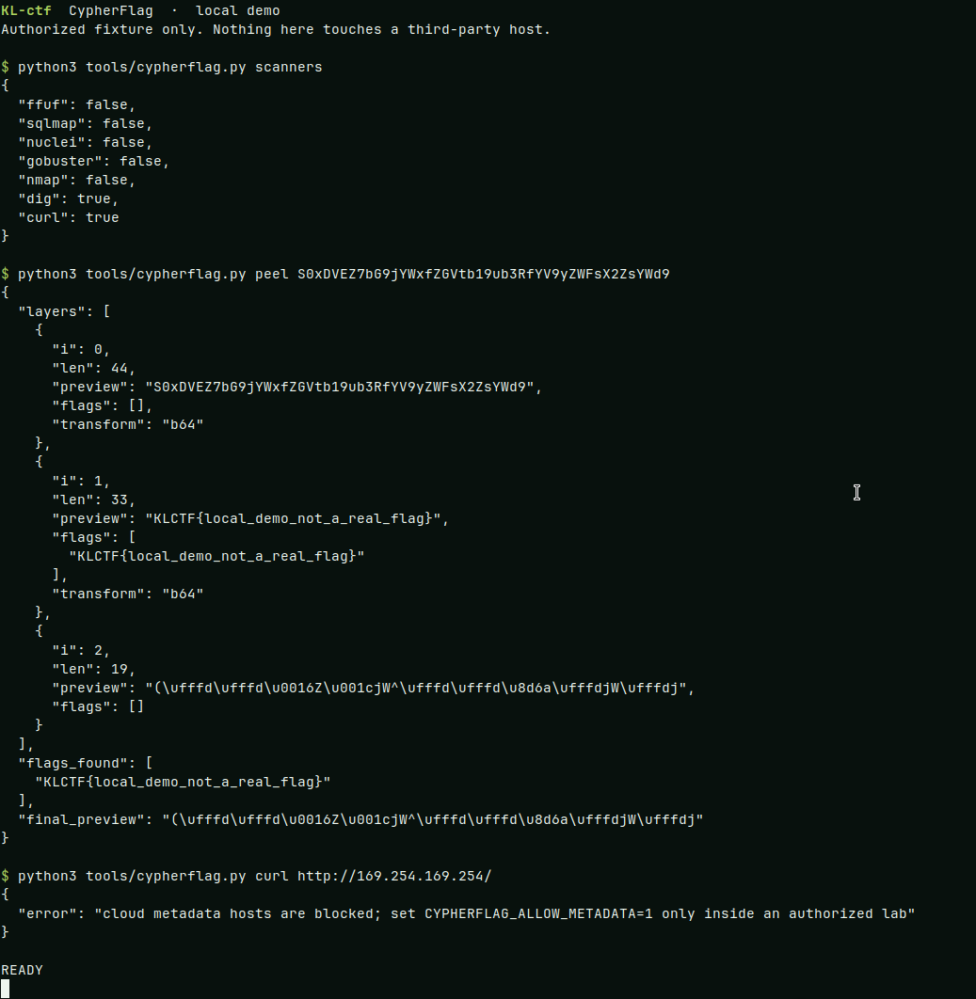
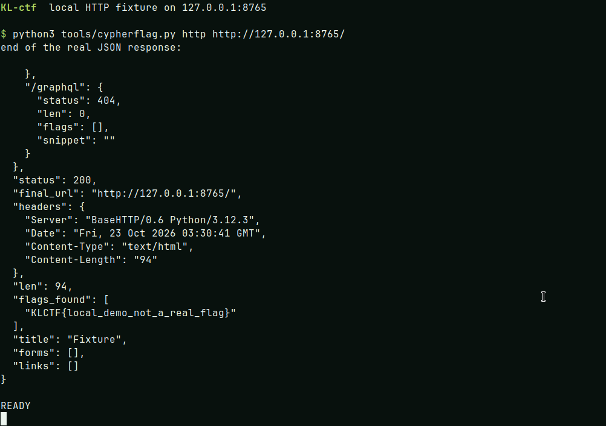
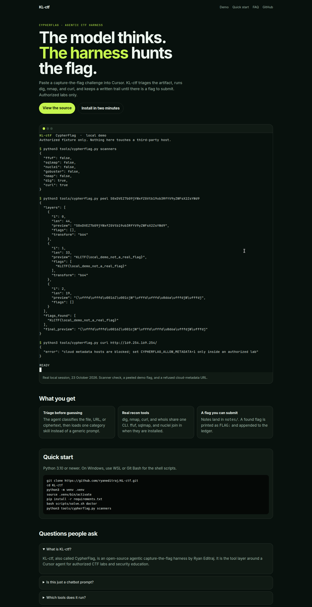

# KL-ctf

**An agentic capture-the-flag harness.** The model is the brain. This repo is the body: tools, category skills, notes, and a human still holding the scope.

Paste a challenge into [Cursor](https://cursor.com). The agent triages the artifact, runs real reconnaissance, and loops until it can hand you a flag to submit. Built for authorized CTF labs and security education.

[](https://github.com/ryaneditraj/KL-ctf/actions/workflows/ci.yml)
[](LICENSE)
[](https://www.python.org/)
[](AGENTS.md)

## Demo

These are real captures from a local run on 23 October 2026, not mockups. Raw logs sit beside the images in [`docs/screenshots`](docs/screenshots).

The first session checks which tools are installed, peels a base64 layer off a local demo string, and refuses a cloud-metadata URL.



The second session serves a one-page fixture on localhost and asks the HTTP helper for a title and a flag.



The docs homepage in [`docs/`](docs/index.html) is what GitHub Pages will serve once it is turned on.



## Features

- **Mechanics-first triage.** The agent classifies a challenge from the file, the URL, or the ciphertext, then loads one category skill.
- **Workshop tools, wrapped.** `dig`, `nmap`, `curl`, and `whois` go through one CLI so the run is logged and flag-shaped strings are collected.
- **Optional scanners.** `ffuf`, `sqlmap`, and `nuclei` run when they are installed. Missing tools are reported, and the rest of the harness still works.
- **A written trail.** Every challenge gets `notes/<slug>/` and any flag is appended to `flags/FOUND.md` as `FLAG: …`.
- **A non-technical operator path.** One person can paste the challenge, approve tool prompts, and submit the flag. See [AALIYA.md](AALIYA.md).
- **Scope stays with a human.** Active scans are for a CTF you joined or a lab you own. Metadata hosts are blocked, TLS is verified by default, and shell commands are not launched through a shell string.

## Tech stack

| Piece | Choice |
|---|---|
| Agent runtime | Cursor Agent (Claude Code can follow the same contract) |
| Harness | Python 3.10+ CLI, `tools/cypherflag.py` |
| HTTP | `requests`, Beautiful Soup, and `curl` |
| Skills | Markdown playbooks in `.cursor/skills/ctf-*` |
| Setup | Bash scripts for macOS Homebrew and Debian packages |
| Tests | `unittest`, localhost only |

Python dependencies and the security floors are in [`requirements.txt`](requirements.txt).

## Quick start

```bash
git clone https://github.com/ryaneditraj/KL-ctf.git
cd KL-ctf
python3 -m venv .venv
source .venv/bin/activate
pip install -r requirements.txt
bash scripts/solve.sh doctor
python3 tools/cypherflag.py scanners
```

On Windows, run the shell scripts in WSL or Git Bash.

On a Mac, the first agent boot can install the workshop tools and scanners:

```bash
bash scripts/install-mac-scanners.sh
```

Approve the Homebrew prompt if macOS asks. That is the only install step a non-technical operator should see.

### On-site operator

Open this folder in Cursor, choose Agent, and send:

```text
I am Aaliya. Boot KL-ctf. Install scanners on my Mac if needed. Teach me the 2-minute version, then wait for challenges.
```

Then paste each challenge, approve tool runs, and submit the `FLAG:` line. The short version is [OPEN_IN_CURSOR.md](OPEN_IN_CURSOR.md). The judge script is [EXPLAIN.md](EXPLAIN.md).

## Usage

Run everything through the CLI so targets are checked before a scanner sees them.

```bash
python3 tools/cypherflag.py scanners
python3 tools/cypherflag.py dig example.com
python3 tools/cypherflag.py nmap --quick 127.0.0.1
python3 tools/cypherflag.py http 'http://127.0.0.1:8080/'
python3 tools/cypherflag.py peel 'BASE64_OR_HEX_BLOB'
python3 tools/cypherflag.py new-challenge web-intro --title "Web intro"
python3 tools/cypherflag.py autosolve --slug web-intro --text-file challenges/web-intro/README.md
python3 tools/cypherflag.py save-flag web-intro 'KLCTF{example}'
```

| Command | What it does |
|---|---|
| `scanners` | Reports which of dig, nmap, curl, ffuf, sqlmap, and nuclei are on `PATH` |
| `dig`, `nmap`, `whois` | DNS, port scan, and registration lookup |
| `curl`, `http`, `recon` | Fetch a page, fingerprint a site, or run dig + nmap + HTTP together |
| `web-hunt`, `ffuf`, `sqlmap`, `nuclei` | Active checks. Authorized targets only |
| `peel`, `extract-flags` | Decode layered encodings and pull out flag-shaped strings |
| `new-challenge`, `autosolve`, `save-flag` | Make the notes folder, take a first pass, record a flag |

`bash scripts/solve.sh doctor` checks the toolchain. `init`, `recon`, and `autosolve` are thin wrappers around the same CLI.

### Environment

| Variable | Default | Meaning |
|---|---|---|
| `CYPHERFLAG_TLS_VERIFY` | `1` | Verify TLS. A self-signed lab certificate is retried once. `0` skips the first check. |
| `CYPHERFLAG_ALLOW_METADATA` | unset | `1` allows cloud metadata addresses. Leave it unset outside a lab that needs them. |

Copy [`.env.example`](.env.example) to `.env` if you want these set for the CLI. The loader ignores every other key.

## Project structure

```text
KL-ctf/
├── tools/cypherflag.py     # CLI: recon, scanners, peel, notes, flags
├── tools/wordlists/        # small path list for lab hunts
├── tools/payloads/         # authorized-lab reference notes
├── scripts/                # doctor, first-run, macOS scanner install
├── .cursor/skills/         # category playbooks the agent loads
├── challenges/             # one folder per challenge (gitignored)
├── notes/                  # triage and trace (gitignored)
├── flags/FOUND.md          # flag ledger
├── docs/                   # homepage, sitemap, screenshots
└── tests/                  # localhost safety tests
```

Design notes for the nine-part harness live in [ARCHITECTURE.md](ARCHITECTURE.md). The agent contract is [AGENTS.md](AGENTS.md). A map of every doc is [docs/INDEX.md](docs/INDEX.md).

## Roadmap

- GitHub Pages for the docs site in `docs/`
- A scope file that limits hosts before an active scan, without changing today's default when the file is absent
- Offline fixture challenges so a demo never needs a network
- JSON Schema for scanner results
- A Windows-native setup path next to the bash scripts
- Pinned GitHub Action SHAs and a release SBOM
- Versioned releases once the CLI surface settles

## FAQ

### What is KL-ctf?

KL-ctf, also called CypherFlag, is an open-source agentic capture-the-flag harness. It is the tool and memory layer around a Cursor agent so a team can hunt flags in an authorized CTF without starting from a blank chat.

### Is this just a chatbot prompt?

No. A chatbot answers once. This harness gives the agent tools (`dig`, `nmap`, `curl`, and optional scanners), category skills, a notes folder, and a loop that keeps going until a flag is found or the operator stops it. Cursor is the runtime. This repository is the harness.

### Who is it for?

Security students, CTF teams, and a non-technical operator who can paste a challenge and approve tool prompts. The reference operator guide is [AALIYA.md](AALIYA.md). Ryan Editraj maintains the project.

### What does the operator do during a match?

Open the folder in Cursor, paste the challenge text, click Allow when a tool needs approval, and submit the `FLAG:` line on the scoreboard. The agent is supposed to run the commands.

### Which tools does the harness run?

The workshop set is `dig`, `nmap`, and `curl`, plus `whois`. When they are installed it can also call `ffuf`, `sqlmap`, and `nuclei`. `python3 tools/cypherflag.py scanners` shows what this machine actually has.

### Can I use it if ffuf, sqlmap, or nuclei are missing?

Yes. The CLI reports them as missing and the Python helpers, notes, and flag ledger still work. The macOS install script is how you add the scanners later.

### Does it work outside macOS?

The Python CLI and the tests run on Linux and on macOS. Scanner install is Homebrew on macOS and `apt` on Debian or Ubuntu. Windows is supported through WSL.

### Where do found flags go?

`python3 tools/cypherflag.py save-flag <slug> '<flag>'` prints `FLAG:` and appends a line to `flags/FOUND.md`. `autosolve` writes a trace under `notes/<slug>/`.

### Is it safe to point at any website?

No. Use it on a CTF you joined, a lab you own, or a host inside a written scope. The CLI refuses non-HTTP URL schemes and cloud metadata addresses, and it verifies TLS by default. Those checks are not a substitute for permission. Read [SECURITY.md](SECURITY.md) before you run an active scan.

### How do I report a security problem?

Open a private advisory at [github.com/ryaneditraj/KL-ctf/security/advisories/new](https://github.com/ryaneditraj/KL-ctf/security/advisories/new). Do not file a public issue for an unfixed vulnerability.

### Who maintains KL-ctf?

[Ryan Editraj](https://github.com/ryaneditraj), an AI builder and tech creator. Questions about the harness go through GitHub issues. Vulnerabilities go through the advisory link above.

## Contributing

See [CONTRIBUTING.md](CONTRIBUTING.md). Please read the [code of conduct](CODE_OF_CONDUCT.md) before you open a pull request. Issues and pull requests use the templates in `.github/`.

```bash
python3 -m unittest discover -s tests -v
bash -n scripts/*.sh
```

## License

[MIT](LICENSE). Copyright 2026 Ryan Editraj.

## Author

**Ryan Editraj** — AI builder and tech creator, with about 295K Instagram followers.

- GitHub: [github.com/ryaneditraj](https://github.com/ryaneditraj)
- Instagram: [instagram.com/ryaneditraj](https://www.instagram.com/ryaneditraj/)
